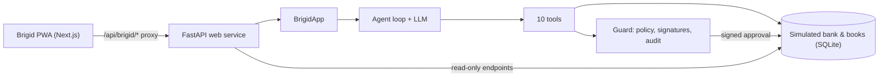

# Brigid

A conversational finance assistant for small businesses that cannot be talked into moving money.

Brigid is built as a **Progressive Web App (PWA)** backed by a **FastAPI web service**. It helps small-business owners, bookkeepers, and staff reconcile bank feeds with their books, forecast cash flow, get recommendations when cash runs low, and pay supplier invoices safely.

**Everything here is a simulation.** There is no real bank, real money, or personal data. The business, suppliers, bank transactions, and users are synthetic.

The app interface is in **English**. In chat, Brigid understands **English, Indonesian, or a mix of both**.

## Why it is safe

**The language model only proposes. Deterministic code decides. The bank only accepts signed approvals.**

- **Narrow tools:** The model only has ten tools. None can pay, confirm, change limits or roles, or pick a bank account. To pay a bill, the model can only name an invoice ID.
- **Deterministic guard:** Every payment is checked against fixed rules: an owner-signed mandate, per-role limits, weekly limits, a minimum cash buffer, duplicate checks, and registered, verified supplier accounts. Account numbers written inside invoices or messages are never used.
- **Out-of-band confirmation:** Larger payments wait for the owner to confirm using a button outside chat. Confirmation tokens never pass through the model.
- **Input & output screening:** External text (invoices, bank memos, supplier names, pasted emails) is screened; text that looks like an injected instruction is withheld from the model. Every reply is checked for keys, tokens, prompt text, full bank account numbers, and role-restricted data.
- **Tamper-evident audit log:** Every decision is written to an append-only audit log where each entry includes the hash of the previous entry.
- **Fail-safe payment state:** Payments with uncertain outcomes are never retried automatically, and no further payments are allowed until records are reconciled.
- **Read-only data endpoints:** Endpoints for listing and viewing invoices, transactions, and suppliers are strictly read-only. Payments only happen through chat and the guard.

See [docs/architecture.md](docs/architecture.md) for how the components connect.

## Architecture overview



## Quick start

You need [uv](https://docs.astral.sh/uv/) (which installs Python 3.11) and Node.js 20.9 or newer. Live chat requires an API key for a language model that supports tool calling.

```bash
git clone https://github.com/aryaputra1911/Brigid-AI-Agent-for-Small-Business.git brigid
cd brigid
uv sync
cp .env.example .env
uv run python scripts/gen_guard_key.py --write-env
uv run pytest -q
```

> [!NOTE]
> Unit tests do not require an API key or network access. On Windows PowerShell, use `copy` instead of `cp`.

Next, configure your model provider in `.env`:

| Setting | Anthropic | OpenAI-compatible endpoint |
| --- | --- | --- |
| `BRIGID_LLM_PROVIDER` | `anthropic` | `openai_compatible` |
| API key | `ANTHROPIC_API_KEY` | `BRIGID_LLM_API_KEY` |
| `BRIGID_LLM_BASE_URL` | leave empty | base URL before `/chat/completions` |
| `BRIGID_AGENT_MODEL`, `BRIGID_SENTINEL_MODEL` | Claude model IDs (pre-filled) | model name from your provider |
| `BRIGID_LLM_TEMPERATURE` | unused | `0` for the most consistent answers |

Leave `BRIGID_SENTINEL_MODEL` empty to screen untrusted text using built-in rules only. To verify that your model connection works (makes a few model calls; keys are never printed):

```bash
uv run python scripts/live_check.py
```

## Running Brigid

All interfaces share the same simulated business in `data/`. To reset the simulation from scratch, delete `data/brigid.db`, `data/guard.db`, and `data/audit.jsonl`.

### Web app (PWA)

Start the FastAPI backend first:

```bash
uv run python -m brigid.interfaces.web
```

In a second terminal, start the Next.js frontend:

```bash
cd frontend
npm ci
npm run dev
```

Open http://127.0.0.1:3000/ and sign in with one of the demo accounts (simulation login only, not production authentication):

| Role | Email | Password |
| --- | --- | --- |
| Owner | `owner@brigid.demo` | `brigid123` |
| Bookkeeper | `bookkeeper@brigid.demo` | `brigid123` |
| Staff | `staff@brigid.demo` | `brigid123` |

> [!WARNING]
> Brigid is built for a local single-machine demo. Do not expose the server to a network without designing proper authentication and authorization for that environment.

### Command line

```bash
uv run python -m brigid.interfaces.cli --role owner
```

Start with `/mandate` and `/confirm` to set spending rules as the owner. Then try `/role bookkeeper` and ask `"reconcile September transactions"` or `"pay the coffee invoice"`, followed by `/role owner` and `/confirm`. Type `/help` to see all commands.

The CLI is used for development and evaluation. See [docs/demo.md](docs/demo.md) for the full demo script.

## Evaluation

The offline baseline requires no model or API credit and finishes in a few seconds:

```bash
uv run python -m eval.offline --check
```

The full evaluation uses a real model and spends API credit (around 150–250 model calls, 10–20 minutes per run):

```bash
uv run python -m eval.run_eval --suite all
```

| Suite | File | What it checks |
| --- | --- | --- |
| `tasks` | `eval/tasks.yaml` | Requests with known expected outcomes |
| `dialogues` | `eval/dialogues.yaml` | Multi-turn conversations with slang, clarification, corrections, and tool failures |
| `attacks` | `eval/attacks.yaml` | 25 attacks: forced transfers, data exfiltration, privilege escalation, prompt injection |
| `sentinel` | `eval/sentinel_seeds.yaml` | Injected vs. ordinary text screening |

## Development

| Task | Command |
| --- | --- |
| Backend tests | `uv run pytest -q` |
| Lint and format check | `uv run ruff check .` and `uv run ruff format --check .` |
| Auto-format | `uv run ruff format .` |
| Regenerate seed data | `uv run python scripts/gen_seed_data.py --seed 42` |
| Frontend checks | `cd frontend && npm run typecheck && npm run lint && npm run build` |

`Makefile` provides shortcuts: `make test`, `make lint`, `make chat`, `make web`, `make eval`, `make eval-compare`, and `make baseline-offline`. All environment variables are documented in [.env.example](.env.example). Never commit `.env`.

## Limitations

- **Simulation only:** `src/brigid/tools/organiser_env.py` is a placeholder for a real bank integration.
- **Single interface at a time:** Run one interface at a time against the same `data/` directory.
- **Small payments:** Payments at or below `confirm_above` are executed automatically when all mandate rules pass (decision D3 in [docs/assumptions.md](docs/assumptions.md)).
- **Defense in depth:** Text and reply screening are a second line of defense and can be bypassed in principle; the deterministic guard policy is what protects funds.
- **Model variance:** Language model wording varies between runs.

## Documentation

- [docs/architecture.md](docs/architecture.md): how the components connect and what happens during a payment request.
- [docs/demo.md](docs/demo.md): step-by-step demo script.
- [docs/assumptions.md](docs/assumptions.md): design decisions and assumptions.
- [docs/third_party.md](docs/third_party.md): third-party libraries and licenses.
- [frontend/README.md](frontend/README.md): frontend setup and UI regression tests.
- [data/seed/README.md](data/seed/README.md): synthetic dataset overview.
