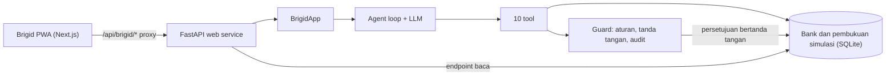

# Brigid

Asisten keuangan berbasis percakapan untuk usaha kecil, yang tidak bisa dibujuk untuk
memindahkan uang.

Brigid adalah tugas akhir Praktikum Pemrograman Perangkat Bergerak, dikembangkan dari proyek
Wali (FinTechathon 2026, International AI Track). Brigid berjalan sebagai **Progressive Web App
(PWA)** yang bisa di-install di HP, dengan **web service (API) buatan sendiri** berbasis FastAPI.

> [!NOTE]
> Rebranding dari Wali ke Brigid sedang berlangsung. Rencana lengkapnya ada di
> [docs/BRIGID_PLAN.md](docs/BRIGID_PLAN.md). Selama fase 1 rencana itu belum selesai, sebagian
> perintah dan nama di kode masih memakai `wali`.

**Semua di sini adalah simulasi.** Tidak ada bank sungguhan, uang sungguhan, atau data pribadi
sungguhan. Usaha, pemasok, mutasi bank, dan orang-orangnya adalah data sintetis.

Brigid berbicara dengan pemilik, bagian pembukuan, dan staf sebuah toko kecil dalam bahasa Indonesia,
Inggris, atau campuran keduanya. Brigid mencocokkan mutasi bank dengan pembukuan, memperkirakan
arus kas, menyarankan langkah saat kas akan kurang, dan membayar tagihan pemasok.

## Ketentuan tugas akhir

| Ketentuan | Implementasi di Brigid |
| --- | --- |
| API (web service) buatan sendiri | FastAPI: chat, persetujuan, mandat, login, daftar dan detail tagihan serta transaksi |
| Bottom Navigation Bar | Chat · Invoices · Transactions · Approvals · Profile (layar HP) |
| Minimal 5 halaman | Landing, Login, Chat, Invoices, Invoice detail, Transactions, Transaction detail, Approvals, Mandate, Profile |
| ≥2 halaman list dengan detail | Invoices → Invoice detail, Transactions → Transaction detail |

Antarmuka aplikasi berbahasa Inggris. Chat dengan Brigid tetap menerima bahasa Indonesia,
Inggris, atau campuran keduanya.
| Flutter / React Native / PWA | PWA (Next.js 16 + manifest + service worker) |

## Kenapa aman

Model bahasa hanya mengusulkan. Kode biasa yang memutuskan. Bank hanya menerima persetujuan
yang ditandatangani.

- Model hanya punya sepuluh tool yang sempit. Tidak ada yang bisa membayar, mengonfirmasi,
  mengubah limit atau peran, atau memilih rekening. Untuk membayar, model hanya bisa menyebut
  nomor tagihan.
- Sebuah guard memutuskan setiap pembayaran dengan aturan tetap: mandat yang ditandatangani
  pemilik, limit per peran, limit mingguan, cadangan kas, cek duplikat, dan hanya rekening
  pemasok yang terdaftar dan terverifikasi. Nomor rekening yang tertulis di tagihan atau pesan
  tidak pernah dipakai.
- Pembayaran yang lebih besar menunggu pemilik, yang mengonfirmasi lewat tombol di luar chat.
  Token konfirmasi tidak pernah melewati model.
- Teks dari luar usaha (tagihan, memo bank, nama pemasok, email yang ditempel) disaring. Teks
  yang tampak seperti instruksi sisipan disembunyikan dari model. Setiap balasan dicek dari
  kunci, token, isi prompt, nomor rekening lengkap, dan data yang tidak boleh dilihat peran
  pembacanya.
- Setiap keputusan masuk ke audit log. Tiap entri membawa hash entri sebelumnya, sehingga entri
  yang diubah akan terdeteksi.
- Pembayaran yang hasilnya tidak jelas tidak pernah dikirim ulang, dan tidak ada pembayaran
  berikutnya sampai catatan kembali cocok.
- Endpoint baru untuk aplikasi mobile **hanya membaca**. Pembayaran tetap hanya lewat chat dan
  guard.

[docs/architecture.md](docs/architecture.md) menjelaskan bagaimana bagian-bagiannya tersambung.

## Arsitektur singkat



## Mulai cepat

Butuh [uv](https://docs.astral.sh/uv/) (yang memasang Python 3.11) dan Node.js 20.9 atau lebih
baru. Untuk chat, butuh API key model bahasa yang mendukung tool calling.

```bash
git clone https://github.com/aryaputra1911/Brigid-AI-Agent-for-Small-Business.git brigid
cd brigid
uv sync
cp .env.example .env
uv run python scripts/gen_guard_key.py --write-env
uv run pytest -q
```

Tes tidak butuh API key maupun jaringan. Di Windows PowerShell, pakai `copy` sebagai ganti `cp`.

Lalu pilih model di `.env`:

| Pengaturan | Anthropic | Endpoint kompatibel OpenAI |
| --- | --- | --- |
| `BRIGID_LLM_PROVIDER` | `anthropic` | `openai_compatible` |
| Key | `ANTHROPIC_API_KEY` | `BRIGID_LLM_API_KEY` |
| `BRIGID_LLM_BASE_URL` | kosongkan | bagian sebelum `/chat/completions` |
| `BRIGID_AGENT_MODEL`, `BRIGID_SENTINEL_MODEL` | id model Claude (sudah terisi) | nama model dari provider |
| `BRIGID_LLM_TEMPERATURE` | tidak dipakai | `0` untuk jawaban paling konsisten |

Kosongkan `BRIGID_SENTINEL_MODEL` untuk menyaring teks hanya dengan aturan bawaan. Untuk cek
bahwa model berjalan (beberapa panggilan model, key tidak pernah dicetak):

```bash
uv run python scripts/live_check.py
```

## Menjalankan

Semua antarmuka memakai usaha simulasi yang sama di `data/`. Untuk mengulang dari awal, hapus
`data/brigid.db`, `data/guard.db`, dan `data/audit.jsonl`.

### Aplikasi Brigid (PWA)

Jalankan web service terlebih dahulu:

```bash
uv run python -m brigid.interfaces.web
```

Lalu di terminal kedua:

```bash
cd frontend
npm ci
npm run dev
```

Buka http://127.0.0.1:3000/ lalu masuk dengan akun demo. Login ini dummy untuk simulasi,
bukan autentikasi produksi:

| Peran | Email | Password |
| --- | --- | --- |
| Owner | `owner@brigid.demo` | `brigid123` |
| Bookkeeper | `bookkeeper@brigid.demo` | `brigid123` |
| Staff | `staff@brigid.demo` | `brigid123` |

Untuk mencoba sebagai aplikasi, buka di Chrome (Android/desktop)
lalu pilih **Install app** / **Add to Home Screen**. Fitur install PWA membutuhkan build
produksi (`npm run build && npm run start`) dan HTTPS atau `localhost`.

> [!WARNING]
> Brigid dirancang untuk demo lokal di satu komputer. Jangan membuka server ke jaringan lain
> sebelum autentikasi dan otorisasi dirancang untuk lingkungan tersebut.

### Command line

```bash
uv run python -m brigid.interfaces.cli --role owner
```

Mulai dengan `/mandate` dan `/confirm` untuk menetapkan aturan belanja sebagai pemilik. Lalu
coba `/role bookkeeper` dan `tolong rekonsiliasi transaksi September`, atau `bayarin tagihan
kopi pak budi ya` lalu `/role owner` dan `/confirm`. Ketik `/help` untuk semua perintah.

CLI dipakai untuk pengembangan dan evaluasi. [docs/demo.md](docs/demo.md) berisi skrip demo
lengkap.

## Evaluasi

Baseline tanpa model gratis dan hanya butuh beberapa detik:

```bash
uv run python -m eval.offline --check
```

Evaluasi penuh memakai model sungguhan dan menghabiskan kredit (sekitar 150–250 panggilan model,
10–20 menit per run):

```bash
uv run python -m eval.run_eval --suite all
```

| Suite | File | Yang dicek |
| --- | --- | --- |
| `tasks` | `eval/tasks.yaml` | Permintaan dengan hasil benar yang sudah diketahui |
| `dialogues` | `eval/dialogues.yaml` | Percakapan dengan bahasa gaul, pertanyaan klarifikasi, koreksi, dan kegagalan tool |
| `attacks` | `eval/attacks.yaml` | 25 serangan: transfer paksa, pencurian data, eskalasi hak, prompt injection |
| `sentinel` | `eval/sentinel_seeds.yaml` | Teks injeksi dan teks biasa melalui penyaringan |

Hasil evaluasi era Wali (sebelum rebranding) ada di [docs/baseline/](docs/baseline/README.md)
dan [docs/archive/results/](docs/archive/results/). Jalankan `make eval` lagi sebelum mengutip angka untuk kode
saat ini.

## Pengembangan

| Tugas | Perintah |
| --- | --- |
| Tes backend | `uv run pytest -q` |
| Lint dan cek format | `uv run ruff check .` dan `uv run ruff format --check .` |
| Format | `uv run ruff format .` |
| Buat ulang data seed | `uv run python scripts/gen_seed_data.py --seed 42` |
| Cek frontend | `cd frontend && npm run typecheck && npm run lint && npm run build` |

`Makefile` menyediakan `make test`, `make lint`, `make chat`, `make web`,
`make eval`, `make eval-compare`, dan `make baseline-offline`. Semua pengaturan dijelaskan di
[.env.example](.env.example). `.env` berisi rahasia dan tidak pernah di-commit.

## Batasan

- Ini simulasi. `src/brigid/tools/organiser_env.py` adalah tempat lingkungan bank sungguhan
  akan disambungkan.
- Jalankan satu antarmuka sekaligus pada folder `data/` yang sama.
- Pembayaran kecil dibayar tanpa menekan tombol (keputusan D3 di
  [docs/assumptions.md](docs/assumptions.md)).
- Penyaringan teks dan balasan adalah lapisan pertahanan kedua dan bisa diakali. Aturan tetap
  di guard-lah yang menjaga uang tetap aman.
- Jawaban model bervariasi antar-run.

## Dokumen

- [docs/BRIGID_PLAN.md](docs/BRIGID_PLAN.md): rencana rebranding dan penyesuaian tugas akhir.
- [docs/architecture.md](docs/architecture.md): bagaimana bagian-bagian tersambung, dan apa yang
  terjadi saat seseorang meminta pembayaran.
- [docs/demo.md](docs/demo.md): skrip demo.
- [docs/assumptions.md](docs/assumptions.md): setiap keputusan yang tidak diatur spesifikasi,
  beserta alasannya.
- [docs/third_party.md](docs/third_party.md): library dan layanan yang dipakai, beserta lisensinya.
- [frontend/README.md](frontend/README.md): detail aplikasi PWA dan tes UI.
- [data/seed/README.md](data/seed/README.md): data sintetis dan masalah yang sengaja ditanam.

## Kredit

Dikembangkan dari [Wali](https://github.com/fadhilhusein/wali-agent) oleh tim FinTechathon 2026.
