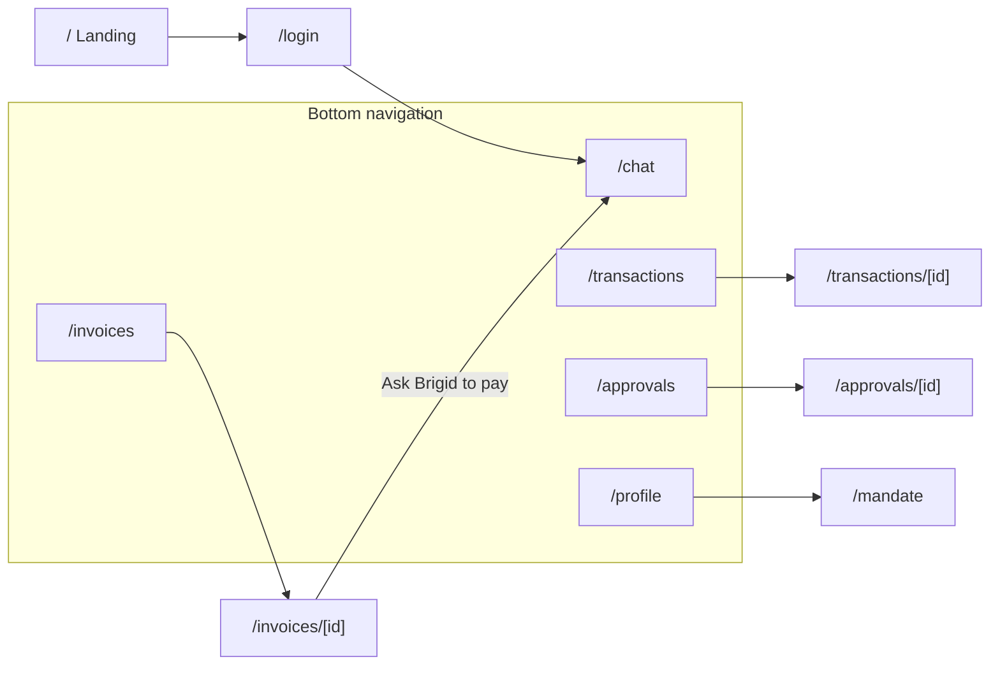

# Rencana Rebranding Wali → Brigid (Tugas Akhir Praktikum Pemrograman Perangkat Bergerak)

Disusun 2026-11-15. Diperbarui 2026-11-15 setelah keputusan pemilik proyek (§11).
Status: **siap dikerjakan, menunggu video latar dan perbaikan terminal agent**.

## 1. Tujuan

Memodifikasi proyek Wali (AI agent keuangan untuk usaha kecil) menjadi **Brigid** dan
menyesuaikannya dengan ketentuan tugas akhir, **tanpa mengubah alur kerja inti** (agent loop,
10 tool, guard, sentinel, audit log, data simulasi). Perubahan dibatasi pada:

1. Rebranding menyeluruh (nama, logo, teks, konfigurasi, dokumentasi).
2. Tampilan baru: landing page dan login page didesain ulang penuh. Halaman platform hanya
   di-restyle tanpa mengubah tata letak, kecuali penyesuaian yang dibutuhkan.
3. Tambahan yang diwajibkan ketentuan: bottom navigation, halaman list + detail, PWA.
4. Fokus pada platform web/PWA. **Bot Telegram dihapus.**

## 2. Pilihan platform: PWA

Frontend saat ini sudah memakai **Next.js 16 (App Router) + TypeScript + Tailwind v4**. Dari tiga
pilihan (Flutter, React Native, PWA), **PWA** paling masuk akal:

- Kode frontend yang ada bisa dipakai ulang, tidak perlu menulis ulang aplikasi.
- Cukup menambahkan web app manifest, service worker, ikon, dan layout yang mobile-first.
- Bisa di-install di HP (Add to Home Screen) dan tampil fullscreen seperti aplikasi native.
- Deploy bisa ke Vercel (MCP Vercel akan ditambahkan pemilik proyek).

## 3. Pemetaan ketentuan

| # | Ketentuan | Kondisi sekarang | Yang perlu dikerjakan |
| --- | --- | --- | --- |
| 1 | API (web service) buatan sendiri | ✅ FastAPI di `src/wali/interfaces/web/app.py` (`/api/info`, `/api/chat`, `/api/pending`, `/api/confirm`, `/api/cancel`, `/api/mandate`, `/api/reset`) | Tambah endpoint baca untuk list dan detail, plus login dummy (§5) |
| 2 | Bottom Navigation Bar | ❌ Hanya sidebar (drawer di HP) | Tambah bottom nav untuk layar HP; sidebar tetap di desktop |
| 3 | Minimal 5 halaman | ⚠️ 4: Landing, Chat, Approvals, Mandate | Tambah Login, Invoices, Transactions, Profile, plus halaman detail (total ±11) |
| 4 | ≥2 halaman utama berupa list, item bisa diklik ke detail | ❌ Belum ada | **Invoices** (list → detail) dan **Transactions** (list → detail). Approvals bisa jadi list ketiga |
| 5 | Flutter / React Native / PWA | Web Next.js | Jadikan PWA (manifest, service worker, ikon, installable) |

## 4. Peta halaman (target)

Bahasa antarmuka: **Inggris**. Chat dengan Brigid tetap menerima bahasa Indonesia, Inggris,
atau campuran, sesuai perilaku agent yang sudah ada.

| Route | Halaman | Jenis | Catatan |
| --- | --- | --- | --- |
| `/` | Landing | Publik | **Desain ulang penuh**, referensi rre.com (§7) |
| `/login` | Login | Publik | **Baru, desain penuh**, login dummy (§5) |
| `/chat` | Chat with Brigid | Utama (bottom nav) | Tata letak tetap, restyle |
| `/invoices` | Invoices | Utama (bottom nav), **list** | Baru. Filter: payable/receivable, status |
| `/invoices/[id]` | Invoice detail | Detail | Baru. Tombol "Ask Brigid to pay" membuka chat dengan prompt terisi, jadi tetap lewat agent dan guard |
| `/transactions` | Transactions | Utama (bottom nav), **list** | Baru. Filter: in/out, periode |
| `/transactions/[id]` | Transaction detail | Detail | Baru |
| `/approvals` | Approvals | Utama (bottom nav), list | Tata letak tetap, restyle |
| `/approvals/[id]` | Approval detail | Detail | Opsional. Konfirmasi tetap memakai `subject_id`, token tidak pernah ke browser |
| `/mandate` | Mandate | Sekunder (dari Profile/sidebar) | Tata letak tetap, restyle |
| `/profile` | Profile & settings | Utama (bottom nav) | Baru. Info user/peran, logout, link ke Mandate, About |

**Bottom navigation (5 item):** Chat · Invoices · Transactions · Approvals · Profile.
Bottom nav muncul di bawah breakpoint `md` (≤768 px). Di desktop sidebar tetap dipakai dengan
item yang sama ditambah Mandate.



## 5. Perubahan API (backend FastAPI)

Prinsip: **hanya menambah endpoint baca dan login dummy**. Tidak ada endpoint baru yang bisa
membayar, mengubah limit, atau mengubah peran. Pembayaran tetap hanya lewat chat →
`propose_payment` → guard.

### Login dummy

- Tiga akun demo dari `data/seed/users.csv` (owner, bookkeeper, staff), masing-masing dengan
  password dummy yang ditulis di README, misalnya `owner@brigid.demo` / `brigid123`.
- `POST /api/login` memeriksa akun demo lalu mengembalikan token sesi acak. Token disimpan
  di memori server dan dikirim ke browser sebagai **cookie httpOnly** oleh proxy Next.js.
- Peran ditentukan dari sesi, bukan dari body request. Ini menggantikan pemilih peran yang
  sekarang. Untuk kompatibilitas, field `role` di body endpoint lama dihapus setelah semua
  halaman beralih ke sesi.
- Tetap simulasi. README menjelaskan bahwa ini bukan autentikasi produksi.

### Endpoint

| Method | Endpoint | Sumber data | Batas akses |
| --- | --- | --- | --- |
| `POST` | `/api/login` | akun demo | – |
| `POST` | `/api/logout` | sesi | – |
| `GET` | `/api/me` | sesi | Login |
| `GET` | `/api/invoices?kind=&status=` | `env.list_invoices` | Staff hanya receivable (sudah ditegakkan `sim_env`) |
| `GET` | `/api/invoices/{id}` | `env.list_invoices` + `get_supplier` | Sama |
| `GET` | `/api/transactions?direction=&from=&to=` | `env.list_transactions` | Owner/bookkeeper saja (sudah ditegakkan `sim_env`) |
| `GET` | `/api/transactions/{id}` | `env.list_transactions` | Sama |
| `GET` | `/api/suppliers/{id}` | `env.get_supplier` | Owner/bookkeeper |

Catatan keamanan:

- Nomor rekening selalu **disamarkan** (mis. `•••• 4821`), sama seperti aturan pada reply checker.
- Teks dari luar (memo, `document_text` tagihan) ditampilkan sebagai teks biasa (escape), tidak
  pernah sebagai HTML. Teks yang ditandai sentinel diberi label "Needs review".
- Semua endpoint baru diberi tes di `tests/` (login, akses per peran, masking, 404).
- Proxy Next.js `/api/wali/*` diganti nama menjadi `/api/brigid/*`.

## 6. Ruang lingkup rebranding dan pembersihan

| Area | Dari | Menjadi |
| --- | --- | --- |
| Paket Python | `src/wali/`, `import wali` | `src/brigid/`, `import brigid` |
| Kelas | `WaliApp` | `BrigidApp` |
| `pyproject.toml` | `name = "wali"`, dependensi `python-telegram-bot` | `name = "brigid"`, dependensi Telegram dihapus |
| Variabel env | `WALI_*` | `BRIGID_*` (`.env.example`, `config.py`, CI) |
| Data | `data/wali.db` | `data/brigid.db` |
| System prompt dan teks antarmuka | "Wali" | "Brigid" (`agent/prompts.py`, CLI, `interfaces/common.py`) |
| Frontend | `wali-web-v2`, `WALI_API_ORIGIN`, `WALI_TEST_ORIGIN` | `brigid-web`, `BRIGID_API_ORIGIN`, `BRIGID_TEST_ORIGIN` |
| Aset | `public/brand/wali.lottie`, `wali.svg`, `wali-180.png` | Logo Brigid baru (§7.3) |
| Metadata | `Wali \| Financial workspace` | `Brigid \| AI finance agent for small business` |
| Makefile, CI, `scripts/`, `eval/`, `tests/` | referensi `wali` | `brigid` |
| Dokumentasi | README, `docs/*.md`, `frontend/README.md` | Diperbarui |
| Git | `fadhilhusein/wali-agent` | `aryaputra1911/Brigid-AI-Agent-for-Small-Business` |

### Dihapus: bot Telegram

- `src/wali/interfaces/telegram_bot.py` (dan modul terkaitnya), tesnya, target `make telegram`,
  variabel `WALI_TELEGRAM_*`, dependensi `python-telegram-bot`, serta bagian Telegram di
  README, `docs/architecture.md`, `docs/demo.md`, dan `docs/third_party.md`.
- Logika konfirmasi yang dipakai bersama (inbox di `app.py`, `interfaces/common.py`) **tetap**,
  karena dipakai web dan CLI.
- CLI tetap dipertahankan sebagai alat pengembangan dan dipakai oleh `eval/`.

### Dokumen era Wali

`PROJECT_AUDIT.md`, `docs/FINALIZATION_PLAN.md`, `docs/audit/`, `docs/results/` dipindahkan ke
`docs/archive/` dengan catatan "dokumen era Wali (FinTechathon 2026)", tidak di-rebrand agar
sejarahnya tetap akurat.

> [!IMPORTANT]
> Mengganti nama di system prompt bisa sedikit menggeser jawaban model. Setelah rebranding,
> `make baseline-offline` harus tetap hijau. `make eval` dijalankan ulang jika ada kredit API.

## 7. Desain

### 7.1 Landing page (referensi: rre.com)

Ciri yang diambil dari rre.com (desain Studio Freight):

- Hero layar penuh dengan **video motion sebagai latar**, overlay gelap atau tekstur dithering
  agar teks tetap terbaca.
- Tipografi besar dan tegas, dipadukan dengan font mono untuk label kecil.
- Palet gelap yang dalam dengan satu warna aksen.
- Section bergerak (reveal saat scroll), bukan layout statis.

Bagian landing: Hero (video) → What Brigid does → How it works (demo workflow yang sudah ada,
di-restyle) → Why it's safe → CTA "Open Brigid" → Footer.

### 7.2 Video latar tanpa membuat landing berat

Pemilik proyek menyediakan video (dari YouTube). Teknik yang dipakai:

1. **Kompres sebelum dipasang** dengan ffmpeg: potong 8–15 detik yang bisa di-loop, tanpa audio,
   1280–1920 px, target **< 2–3 MB**.
   ```bash
   ffmpeg -i input.mp4 -t 12 -an -vf "scale=1920:-2,fps=24" -c:v libvpx-vp9 -b:v 0 -crf 38 public/landing/hero.webm
   ffmpeg -i input.mp4 -t 12 -an -vf "scale=1920:-2,fps=24" -c:v libx264 -crf 28 -preset slow -movflags +faststart public/landing/hero.mp4
   ffmpeg -i input.mp4 -t 12 -an -vf "scale=960:-2,fps=24" -c:v libvpx-vp9 -b:v 0 -crf 40 public/landing/hero-mobile.webm
   ffmpeg -i input.mp4 -frames:v 1 -vf "scale=1920:-2" -q:v 3 public/landing/hero-poster.webp
   ```
2. **Poster dulu, video belakangan.** Gambar poster (WebP, < 150 KB) tampil seketika dan menjadi
   LCP. Video baru dimuat setelah halaman siap (`preload="none"`, mulai saat idle).
3. **`<video autoplay muted loop playsinline>`** dengan dua `<source>`: WebM (VP9) lalu MP4
   (H.264) sebagai cadangan, plus versi kecil khusus HP lewat media query.
4. **Hormati pengguna:** tidak memutar video jika `prefers-reduced-motion`, mode hemat data
   (`navigator.connection.saveData`), atau koneksi 2G/3G. Cukup poster saja.
5. **Pause saat tidak terlihat** dengan IntersectionObserver dan `visibilitychange`.
6. **Tidak di-cache service worker** saat install PWA (hanya app shell), supaya install tetap
   ringan.
7. Shader Paper yang sekarang ada di landing dilepas dari hero agar tidak ada dua efek berat
   sekaligus.

Target: Lighthouse Performance mobile ≥ 90, LCP < 2,5 detik.

> [!WARNING]
> Pastikan video dari YouTube boleh dipakai ulang (lisensi Creative Commons atau bebas royalti),
> atau ambil dari sumber stok gratis seperti Pexels atau Mixkit. Cantumkan sumbernya di
> `docs/third_party.md`.

### 7.3 Logo

Dibuat dengan skill `logo-design-skill` (kaankiziltug). Alur skill tersebut: brief → riset
klise kategori → matriks konsep → **checkpoint persetujuan pemilik** → SVG final → uji favicon
16 px, ikon aplikasi, dan versi monokrom.

Aset yang dihasilkan: `brigid.svg`, `brigid-mono.svg`, favicon, PNG 180/192/512, ikon maskable
512 untuk PWA, dan animasi loading pengganti `wali.lottie` (Lottie, atau animasi SVG/CSS jika
lebih sederhana).

### 7.4 Login page dan halaman platform

- Login: satu kolom di HP, split layout di desktop dengan visual dari identitas landing. Ada
  tombol cepat "Use demo account" untuk tiap peran.
- Halaman platform: tata letak tetap. Yang diganti palet, tipografi, logo, dan komponen agar
  konsisten dengan identitas Brigid.
- Mobile-first: target lebar 320–430 px, safe area (`viewport-fit=cover`), tap target ≥44 px.
- Audit akhir dengan `anti-slop` dan `ui-ux-pro-max`.

## 8. Fase pengerjaan

| Fase | Isi | Selesai jika |
| --- | --- | --- |
| 0. Persiapan | Perbaiki terminal agent, rename folder, remote git ke repo Brigid, `bash scripts/setup-skills.sh`, `uv sync`, `npm ci`, tes awal | `uv run pytest -q` dan `npm run typecheck` hijau sebelum ada perubahan |
| 1. Rebranding dan pembersihan | Rename paket, kelas, env, data, prompt, frontend, CI. Hapus Telegram. Arsipkan dokumen era Wali | Semua tes hijau, `grep -ri wali` hanya menyisakan `docs/archive/` dan kredit |
| 2. Logo | Alur `logo-design-skill` sampai aset final | Pemilik menyetujui konsep, semua ukuran ikon tersedia |
| 3. API baru | Login dummy, sesi, endpoint list dan detail, beserta tes | Tes baru hijau, tidak ada tool atau guard yang berubah |
| 4. PWA | Manifest, service worker (cache app shell, API dan video tidak di-cache), ikon, halaman offline | Lighthouse "installable", bisa di-install di Android |
| 5. Halaman baru | Login, Invoices (+detail), Transactions (+detail), Profile, bottom nav | Semua route jalan di 320–1440 px |
| 6. Desain | Landing baru dengan video, login baru, restyle halaman platform | Review desain disetujui, Lighthouse mobile ≥ 90 |
| 7. QA | Code review (skill `code-reviewer`), anti-slop, Playwright, demo end-to-end | Checklist ketentuan §3 terpenuhi semua |
| 8. Deploy dan dokumentasi | Deploy (Vercel lewat MCP), README, `docs/architecture.md`, `docs/demo.md`, screenshot | Siap dikumpulkan |

> [!NOTE]
> Vercel hanya menjalankan frontend Next.js. Backend FastAPI (Python + SQLite) butuh tempat
> sendiri, misalnya Render, Railway, atau Fly.io, atau cukup demo lokal. Diputuskan di fase 8.

## 9. Skills

Semua dipasang dengan satu perintah dari root repo:

```bash
bash scripts/setup-skills.sh
```

Isi skrip:

| Skill | Perintah | Dipakai di fase |
| --- | --- | --- |
| clone-website | `npx skillfish add hemkumar247/ai-skills clone-website` | 6 (referensi landing) |
| code-reviewer | `npx skillfish add swiftyjunnos/claude-code-with-tdd code-reviewer` | 7 |
| anti-slop | `agy plugin install https://github.com/miqdadbadjuber/anti-slop` | 6, 7, 8 |
| ui-ux-pro-max | `npm install -g ui-ux-pro-max-cli` | 6 |
| logo-design | `git clone https://github.com/kaankiziltug/logo-design-skill .agents/skills/logo-design` | 2 |

Rekomendasi tambahan (opsional):

| Skill | Kegunaan |
| --- | --- |
| `anthropics/skills` → `webapp-testing` | Tes UI dengan Playwright (proyek ini sudah memakai Playwright) |
| `vercel-labs/agent-skills` → `react-best-practices` | Praktik Next.js/React untuk halaman baru |
| `vercel-labs/agent-skills` → `web-design-guidelines` | Audit aksesibilitas dan UX |

MCP: **Vercel** (akan ditambahkan pemilik proyek) untuk deploy dan preview.

## 10. Saran tambahan (opsional)

- Kartu ringkas di Chat: saldo dan jumlah approval yang menunggu.
- Pull-to-refresh dan skeleton loading pada list.
- Badge jumlah approval pada ikon bottom nav.
- Mode gelap (cocok dengan palet gelap gaya rre.com).
- Halaman offline PWA ("Brigid needs a connection to chat").

## 11. Keputusan

| # | Pertanyaan | Keputusan |
| --- | --- | --- |
| 1 | Login | Dummy untuk simulasi (§5) |
| 2 | Bahasa UI | Inggris |
| 3 | Logo | Dibuat dengan `logo-design-skill` |
| 4 | Telegram | Dihapus. Fokus ke platform web/PWA |
| 5 | Desain landing | Referensi rre.com, latar video motion yang dioptimalkan |
| 6 | Dokumen era Wali | Diarsipkan ke `docs/archive/` (usulan agent, bisa diubah) |
| 7 | CLI | Dipertahankan sebagai alat pengembangan dan evaluasi (usulan agent, bisa diubah) |

Masih ditunggu: **file video latar** dan **MCP Vercel**.

## 12. Kendala lingkungan saat ini

- Terminal agent gagal dijalankan (`fork/exec /snap/antigravity-cli/24/bin/bash: permission
  denied`). Instalasi skill, `git`, tes, dan build belum bisa dijalankan oleh agent. Perbaiki
  dengan `sudo snap refresh antigravity-cli` atau install ulang. Sementara itu, jalankan
  `bash scripts/setup-skills.sh` secara manual.
- Nama folder `agent for small business` mengandung spasi. Disarankan rename menjadi `brigid`.
